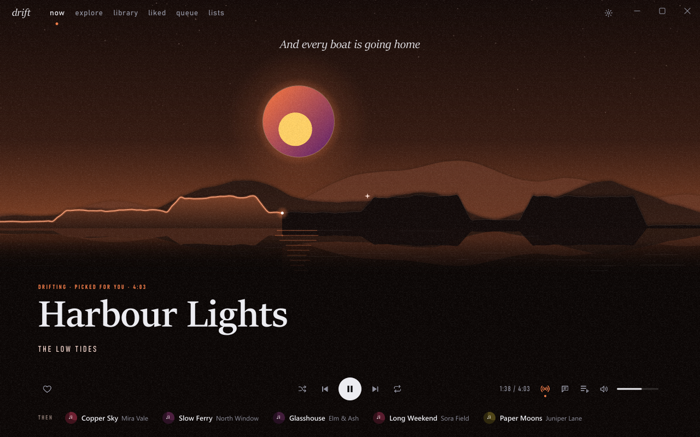
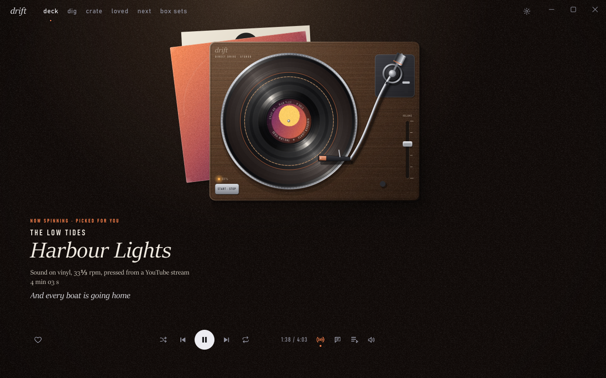
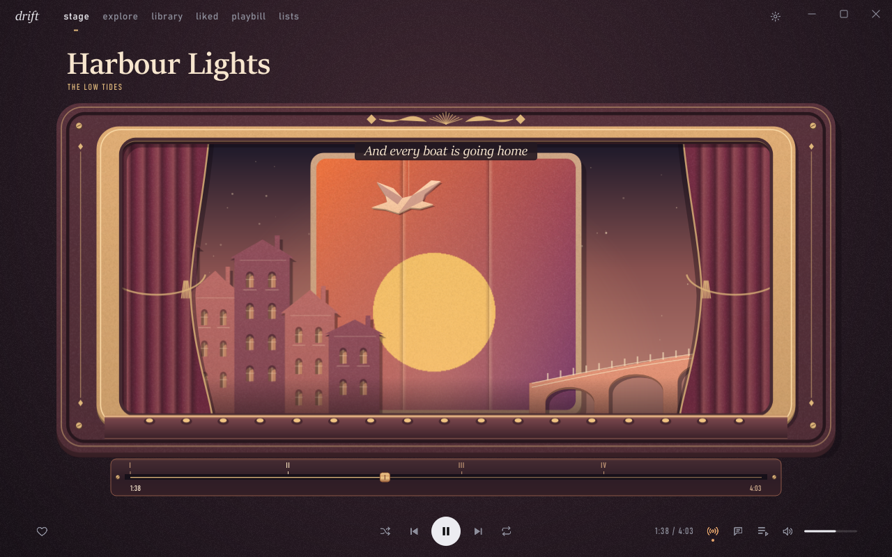

<p align="center"></p>

# Drift

**A music player for Windows that turns every song into a place.**

Drift plays the music on your PC and streams from YouTube Music, YouTube and SoundCloud. Its radio learns what you like and keeps playing while you're online. When you're offline it carries on with your saved songs.

- **Every song is a landscape.** The song's loudness becomes the hills (and the seek bar), the cover becomes the sun, and the lyrics drift above.
- **Three rooms to listen in.** Sunset, Vinyl (a turntable whose grooves are the song) and Paper Theatre (a cut-paper stage you scrub with a brass cue rail). You can also write your own room in JavaScript, with live redraw as you edit.
- **Tiny sound engine.** Playback runs in `drift-core.exe`, about 1.3 MB of Rust (rodio and symphonia), using a few MB of memory. It owns the tray icon and media keys, and the music keeps playing after you close the window.
- **Studio finish.** Every song is levelled to the same loudness (ITU BS.1770 true-peak guard), with soft limiting and gentle fades.
- **Radio that listens.** It ranks picks around what you're playing now, learns from your plays and early skips, spaces out repeat artists and never plays the same recording twice from different uploads.
- **Offline first.** Saved songs keep their covers and lyrics on disk.
- **Paste a link.** YouTube, SoundCloud or a Spotify track, album or playlist link. Spotify links are only used to read the track list; playback comes from the other sources.

| Vinyl | Paper Theatre |
|---|---|
|  |  |

## Install

Download `Drift-windows.zip` from [Releases](../../releases), unzip it anywhere and run `Drift.exe`. Windows 10 or 11.

Windows SmartScreen will warn you the first time, because the app isn't code-signed. Click **More info**, then **Run anyway**.

## Build from source

You need Python 3.12 and Rust (stable).

```
pip install -r requirements.txt
python build.py
```

`build.py` builds the Rust core and the window, installs to `%LOCALAPPDATA%\Programs\Drift`, adds Start menu and desktop shortcuts and starts Drift. Use `python build.py --no-install` to build into `dist/` only.

To run straight from source, build the core once (`cargo build --release` in `core/`), then run `python -m drift`.

Tests: `python -m unittest discover -s tests -p "test_*.py"` (offline) and `cargo test` in `core/`.

## How it's built

| Part | What it does |
|---|---|
| `core/` | `drift-core.exe` (Rust): sound, queue, tray icon, media keys, loudness and the song's shape. Talks to the window over line JSON on localhost. |
| `drift/` | The window (PyQt6): library (SQLite), online sources (ytmusicapi, yt-dlp), taste and radio, lyrics, pages. |
| `drift/ui/sketches/` | The rooms. Built-ins are Python; your own rooms are `sketch.js` files run in a sealed JavaScript engine. Start with `guide.html`. |

## How it was made

I'm not a programmer. Drift was built with AI coding agents (Claude Code and Codex): I decided what it should be and feel like, and they wrote the code.

## Notes

Drift doesn't host or ship any music. Respect the terms of the services you use and the rights of the artists you listen to.

## Licence

GPL-3.0 (see [LICENSE](LICENSE)). Drift uses PyQt6 (GPL-3.0), Qt (LGPL-3.0), yt-dlp (Unlicense), ytmusicapi (MIT), mutagen (GPL-2.0+), rodio (MIT/Apache-2.0) and symphonia (MPL-2.0).
